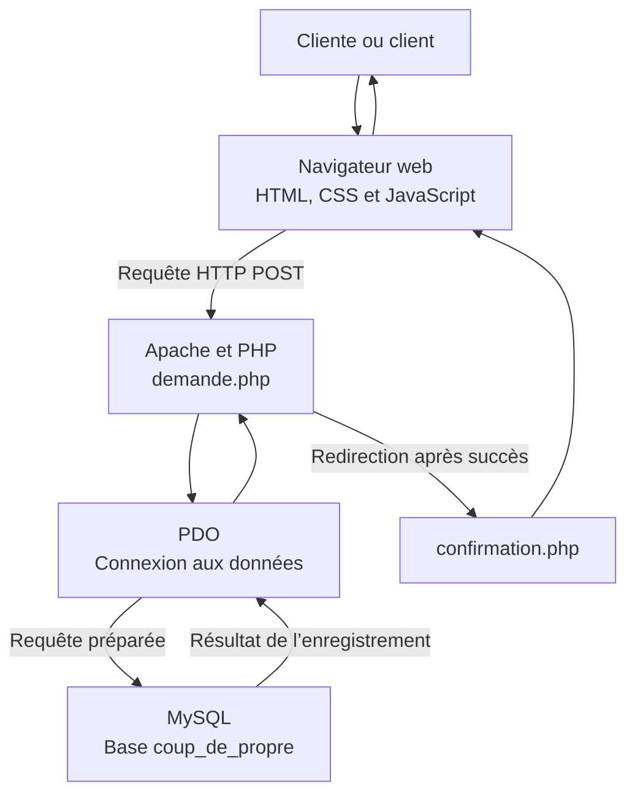

# Architecture technique — Coup de Propre

L’application suit une architecture web client-serveur. Le navigateur affiche le site et transmet le formulaire à PHP. PHP utilise PDO pour enregistrer la demande dans MySQL.

## Environnement local

- **XAMPP** lance Apache, PHP et MySQL sur l’ordinateur.
- **phpMyAdmin** permet de consulter la base et la table `demandes`.
- **Visual Studio Code** sert à modifier les fichiers du projet.
- **Git et GitHub** pourront servir à suivre et sauvegarder les versions du code.