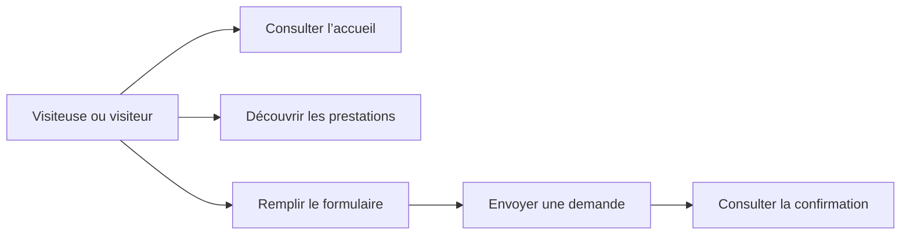

# Diagramme de cas d’utilisation — Coup de Propre

Le visiteur peut consulter les prestations, envoyer une demande de ménage et obtenir une confirmation.

## Acteur

- **Visiteuse ou visiteur** : consulte le service et peut envoyer une demande de ménage.

## Cas d’utilisation

- Consulter la page d’accueil et les engagements de Coup de Propre.
- Découvrir les prestations proposées.
- Remplir le formulaire avec ses coordonnées et la date souhaitée.
- Envoyer une demande.
- Voir le résultat de l’envoi.